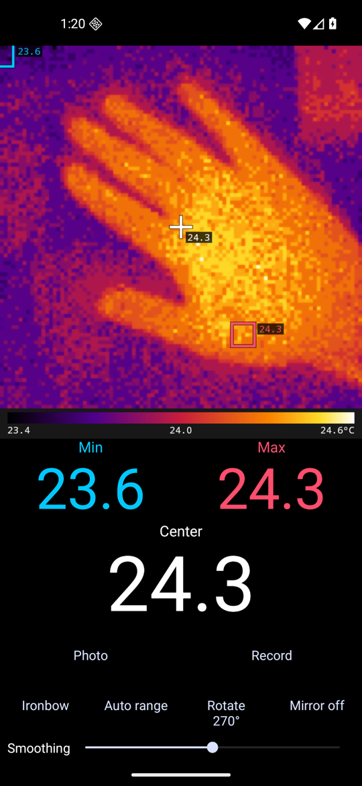

# tc001-mini-android



A small Android viewer for the TOPDON TC001 Mini thermal camera. No vendor SDK, no network access, no account.

Plug the camera in: the app opens on the live thermal image with a colour scale, the hottest and coldest spots marked with their temperature, and the centre temperature. Photos and videos go to the phone gallery.

## Features

- Live view at the camera's 25 fps, read straight from USB (UVC bulk stream, 96x96 temperatures).
- Palettes: ironbow, white-hot, black-hot. Auto range, or lock the current range.
- Hot / cold spot markers (3x3-smoothed, with hysteresis so noise does not make them jump) and a centre crosshair.
- Large Min / Max / Center readouts, readable at arm's length.
- Turn the phone sideways: the layout stays put and the picture and readouts turn to read upright (the scale moves beside the image and Min, Max and Center stack), as in a camera app. Upside down, the whole app turns like portrait, picture next to the camera. Both follow the phone even with auto-rotate off and are held from Record to Stop.
- Rotation (90° steps, for a camera mounted another way), mirror, display smoothing. Settings are kept across launches.
- Photo (button or either volume key): the picture as shown on screen (768 x 832 upright, 832 x 768 sideways) plus the raw frame.
- Video: H.264 MP4 of the picture, same sizes, no audio; the size is held from Record to Stop.
- Re-plugging the camera resumes the stream.

## Install

Download `tc001-mini-<version>.apk` from the [latest release](https://github.com/babs/tc001-mini-android/releases/latest) and open it on the phone (allow installs from your browser or file manager when asked).

To get updates, add the repository URL to [Obtainium](https://github.com/ImranR98/Obtainium): it watches the GitHub releases and installs new versions. The app itself has no network access.

Release APKs are signed with this certificate (SHA-256):

```
6E:AD:00:D4:2A:19:CF:1E:A2:30:3A:DA:72:55:15:30:12:C0:A8:4D:42:6A:1B:EE:0A:6C:78:50:37:E0:60:E2
```

Each release APK also has a GitHub build provenance attestation: `gh attestation verify tc001-mini-<version>.apk --repo babs/tc001-mini-android`.

## Supported hardware

- TOPDON TC001 Mini (USB `2bdf:0102`). Other TOPDON models are not supported.
- Android 10 (API 29) or later, with USB host (USB-C OTG).

## Permissions

The only permission is `android.permission.CAMERA`, asked when the camera is plugged in: Android 9+ grants USB access to a UVC camera only to apps holding it. There is no `INTERNET` permission and no storage permission (files are written through MediaStore).

## Files

| What | Where |
|---|---|
| Photo, as displayed | `Pictures/TC001/TC001_<timestamp>.png` |
| Raw frame of the same instant | `Documents/TC001/TC001_<timestamp>.bin` |
| Video | `Movies/TC001/TC001_<timestamp>.mp4` |

The `.bin` is the untouched 18,568-byte mode-2 frame: a 136-byte header followed by 96x96 little-endian `uint16`, `celsius = raw / 64 - 50`.

Each photo PNG carries a `tEXt` chunk with keyword `tc001` holding the readouts and view settings as JSON:

```json
{"min":23.4,"center":23.8,"max":24.2,"lo":23.2,"hi":24.2,"palette":"ironbow","rotation":0,"orientation":90,"mirror":false,"smoothing":0.45,"locked":false,"time":"2026-11-20T00:48:57.328+01:00"}
```

`rotation` is the Rotate setting, `orientation` the phone turn the picture was drawn for (0, 90, 180, 270, clockwise from portrait); like the screen, it is held from Record to Stop, so a photo taken while recording matches the screen, not the phone. Read it with `exiftool -Tc001 photo.png`.

## Build

Requires a JDK 17+ and the Android SDK (platform 36); point `ANDROID_HOME` or `sdk.dir` in `local.properties` at it.

```sh
./gradlew assembleDebug
adb install app/build/outputs/apk/debug/app-debug.apk
```

For a release build, put `keys/keystore.properties` (`storeFile`, `storePassword`, `keyAlias`, `keyPassword`; the `keys/` folder is git-ignored) next to your keystore and run `./gradlew assembleRelease`: it writes `app/build/outputs/apk/release/app-release.apk`. Without that file the release APK is `app-release-unsigned.apk` and must be signed with `apksigner` before installing.

Pushing a tag `vX.Y.Z` runs the release workflow. A first job builds the unsigned APK with `versionName` = the tag without its `v` and `versionCode` = the commit count (it fails if that count is lower than another release tag's). A second job signs it with the key held in the repository secrets (`TC001_KEYSTORE_B64`, `TC001_KEYSTORE_PASSWORD` used for both the store and the key, `TC001_KEY_ALIAS`), checks the certificate against the one above, attests it and attaches it to a GitHub release. Tags `vX.Y.Z-*` are published as pre-releases.

The debug build replays a bundled capture when no camera is attached, so the UI can be tried on an emulator.

`./gradlew check` runs the unit tests and lint, and fails if the release build gains a third-party runtime dependency or any permission other than `CAMERA`. `assembleRelease` fails if the APK grows past 5 MB.

## Specs

Feature specs and their acceptance criteria are in [`specs/`](specs/).

## License

[MIT](LICENSE)
